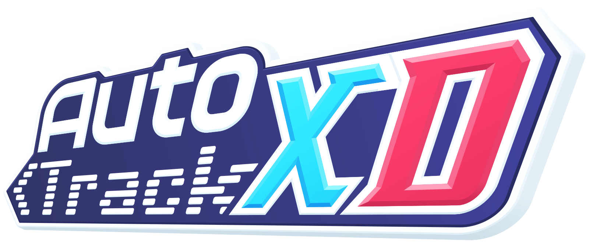
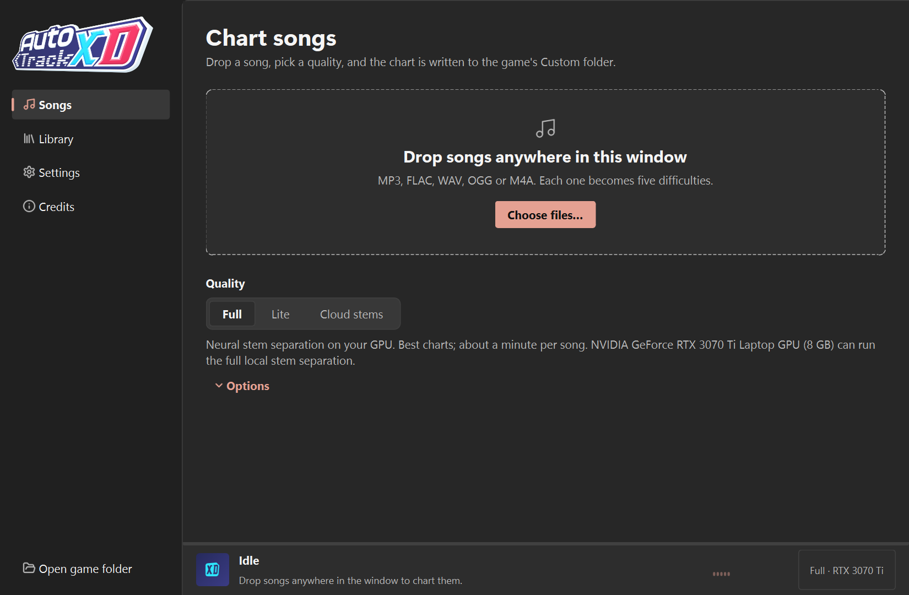
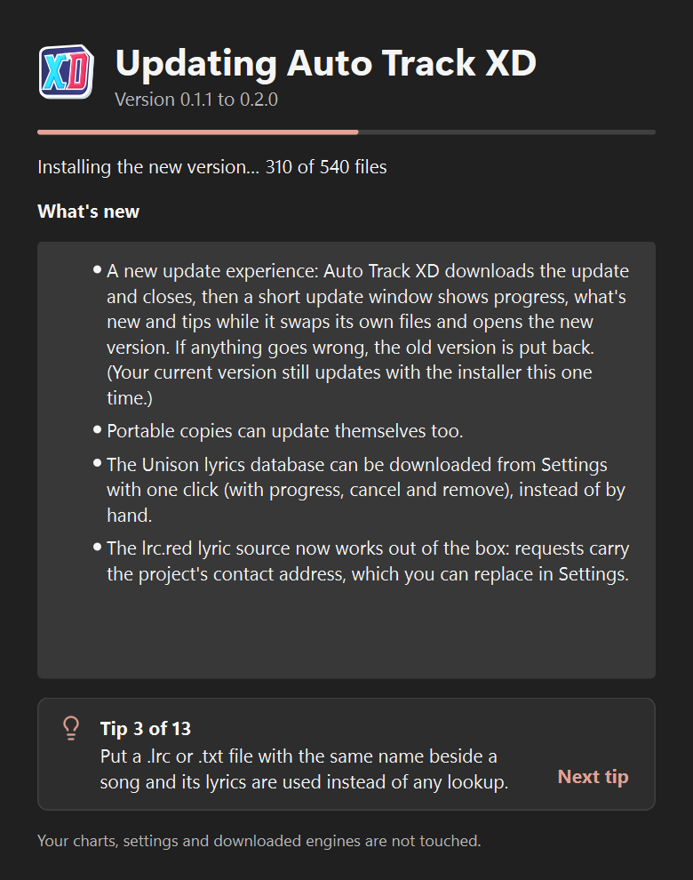

<p align="center"></p>

<p align="center"><b>Drop in a song. Get a playable custom chart for Spin Rhythm XD.</b></p>

Auto Track XD is a Windows app that turns an audio file into a custom chart for [Spin Rhythm XD](https://www.spinrhythm.com): five difficulties, the game's full set of notes, album art, synced lyrics, and a title and category that look right in the song list. Charts are written straight into the game's `Custom` folder. Restart the game and they are there.



> **This repository holds the downloads and this guide only.** There is no source code here. Get the app from [Releases](../../releases/latest).

## Get started

1. **Download** `AutoTrackXD-<version>-setup.exe` from the [latest release](../../releases/latest) and run it. It installs for your user only and needs no administrator rights. (Windows may warn you first: see [Windows will warn you](#windows-will-warn-you).)
2. **Install an engine** the first time you open the app. The app is small; the part that analyses music (PyTorch and friends) is downloaded once, from pytorch.org and PyPI, and you choose which:
   - **Lite** (about 0.4 GB download, 0.8 GB on disk) works on any PC.
   - **Full** (about 3.2 GB download, 7 GB on disk) uses an NVIDIA graphics card for the best charts and synced lyrics.
3. **Drop songs** anywhere on the window (MP3, FLAC, WAV, OGG or M4A), or press **Ctrl+O**.
4. **Restart Spin Rhythm XD.** Your new charts are in the song list.

You also need [ffmpeg](https://ffmpeg.org) on your PATH (`winget install Gyan.FFmpeg`). The app tells you if it is missing.

## What it makes

- **All five difficulties** (Easy, Normal, Hard, Expert, XD) from one analysis, using every note type the game has: taps, beats, spins, scratches, holds and drags.
- **Charts that feel like the game's own.** Note counts, spacing and difficulty ratings are learned from the official charts, so Easy stays easy and XD scales with the song.
- **The same chart every time** for the same song. Not happy with it? **Reroll** gives a different take.
- **Careful beat finding.** Tempo is checked section by section, and you can fix a song the analysis gets wrong (see [Fixing a song](#fixing-a-song)).
- **Synced lyrics** in the game's own format, aligned to the vocals on your PC. Japanese and Korean are shown as romaji. A `.txt` or `.lrc` file next to the song always wins.
- **Proper names.** Titles are romanised or localised, the in-game category comes from the song's franchise or genre, and album art comes from the file, an image beside it, or an online lookup.
- **It never overwrites a chart it did not write.** Charts it makes carry a marker, and your other custom charts are left alone.

## Quality

The app checks your PC and recommends one. You can change it per batch, or set the default in Settings.

| Quality | What it does | Needs |
|---|---|---|
| **Full** | Separates the song into drums, bass, vocals and the rest with a neural network, on your GPU. Best charts; about a minute per song. Synced lyrics need it. | An NVIDIA graphics card with about 6 GB of video memory and a recent driver (570 or newer). |
| **Lite** | Fast analysis without separating stems. Good charts in seconds. No synced lyrics. | Any PC. |
| **Cloud stems** | Stems made by the [MVSEP](https://mvsep.com) web service. **Uploads the song's audio**, so it asks first and is off by default. | An MVSEP API key. |

## Fixing a song

Open the **Library**, pick a song, and use the **Fix** tab: correct the title, artist or category, set the tempo and beats per bar, make the chart busier or calmer with note density, follow the melody, or nudge or replace the lyrics. **Apply and regenerate** makes the chart again.

## Updating

The app checks this page for a newer version once a day (you can turn that off in Settings) and shows a banner when there is one. **Update now** downloads the update, checks it against the published checksums, and closes. A short update window then shows progress, what is new and a few tips while it swaps its own files and opens the new version.



If anything goes wrong the old version is put back and opened again. Your charts, settings and downloaded engines are never touched. Portable copies update themselves the same way.

## Which file

| File | What it is |
|---|---|
| `AutoTrackXD-<version>-setup.exe` | The installer. It installs for your user only and needs no administrator rights. |
| `AutoTrackXD-<version>-portable.zip` | The same app with no install. Unzip it anywhere; it keeps its data in a `data` folder beside the program. |
| `SHA256SUMS.txt` | Checksums for the two files above. |

## Windows will warn you

The downloads are not code-signed, so Windows SmartScreen may say "Windows protected your PC". Choose **More info**, then **Run anyway**. To check that a file is the one that was published, compare its SHA-256 with `SHA256SUMS.txt`:

```powershell
Get-FileHash .\AutoTrackXD-<version>-setup.exe -Algorithm SHA256
```

## Problems

| What you see | What to do |
|---|---|
| The app says ffmpeg is missing | Install it with `winget install Gyan.FFmpeg`, then reopen the app. |
| **Full** is greyed out | It needs an NVIDIA graphics card and a driver 570 or newer. Use **Lite**, or update your driver. |
| The engine install says "untrusted mount point" (error 448) | Fixed in 0.1.1. On 0.1.0, open the app from the Start menu instead of the installer's last page, or update. |
| The engine install says there is not enough disk space | Lite needs about 0.8 GB free, Full about 7 GB. |
| A chart is not in the game | Restart Spin Rhythm XD. Charts are written to `%USERPROFILE%\AppData\LocalLow\Super Spin Digital\Spin Rhythm XD\Custom`; **Open game folder** in the app takes you there. |
| The tempo or lyrics of one song are wrong | Use the **Fix** tab in the Library. |

Still stuck? [Open an issue](../../issues) and paste the text from **Settings > Copy diagnostics**. It has the app and Windows versions, your hardware and your settings, and no song names, file paths or lyrics.

Your settings, cache and engines live in `%LOCALAPPDATA%\autotrack-xd` (a portable copy keeps them in its `data` folder). The uninstaller asks before removing them. Charts already in the game are never removed.

## Privacy

Your audio never leaves your PC, except in the optional Cloud stems quality, which asks first. Looking up lyrics, categories and album art sends only text about the song (title, artist, album, length), and every lookup has a switch in Settings. Lyric lookups also send the project's contact address to lrc.red, because that service asks for one; you can replace it in Settings. The Unison lyrics database is a copy you download once and search on your own PC. There is no telemetry.

## Credits

Auto Track XD stands on [Beat This!](https://github.com/CPJKU/beat_this) for beat tracking, [Demucs](https://github.com/facebookresearch/demucs) for stem separation, [LRCLIB](https://lrclib.net), [lrc.red](https://lrc.red) and the [Unison](https://unison.betterlyrics.org) community database for lyrics (Unison is licensed for people and non-profits, and asks for credit), [MusicBrainz](https://musicbrainz.org) and others. The app's **Credits** page lists everything it uses and under which licence.

## Not affiliated

Auto Track XD is an independent fan tool. It is not affiliated with or endorsed by Super Spin Digital. Spin Rhythm XD is their game.
